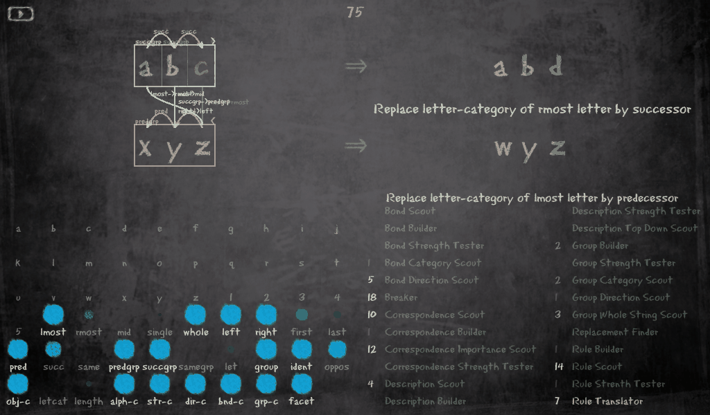

# Melanie's Copycat

Melanie Mitchell's original Copycat, the Lisp program of her 1990 dissertation and of
*Fluid Concepts and Creative Analogies*, running again, and shown live in a modern window.
Copycat makes analogies between letter strings: given `abc → abd`, what is `xyz → ?`.



Four folders, from the original to the window:

| Folder | What |
|---|---|
| [`Melanie-Mitchell-[LISP]/`](Melanie-Mitchell-%5BLISP%5D/) | Her source as she distributed it (Lucid Common Lisp + Flavors, 44 `.l` files and `ccat.tar.gz`). Read-only: nothing here is ever edited. |
| [`melanies-copycat/`](melanies-copycat/) | **Her code running on SBCL**, headless. Her files unchanged in `src/`; a Lucid and Flavors compatibility layer in `compat/`; seeded, reproducible runs; `RESULTS.md` compares six problems over 100 seeds with the figures in FCCA chapter 5. |
| [`copycat-opengl/`](copycat-opengl/) | Joseph Aaron Hager's Python translation of Copycat with his pyglet (OpenGL) GUI, repaired for Python 3.12, the GUI now drawing bonds, groups, correspondences and the rule. GPL v2. |
| [`melanies-opengl/`](melanies-opengl/) | **Her engine in his window**: SBCL runs her program and writes one JSON line per codelet; a small adapter feeds Hager's client unchanged. The README walks through a run that ends in `wyz`. |

## Quick start

```sh
cd melanies-copycat && ./run-copycat.sh abc abd xyz 43          # her program, headless: rule, answer wyz, temperature, codelets
cd melanies-copycat && bash tests/run-tests.sh                   # about a minute

python3 -m venv ~/dev/copycat-opengl-venv                        # pyglet 2 for the window
~/dev/copycat-opengl-venv/bin/pip install -e 'melanies-opengl[gui,test]'
cd melanies-opengl && ~/dev/copycat-opengl-venv/bin/python -m melanies_opengl abc abd xyz --seed 43
```

Needs SBCL for her program and Python 3.10 or later for the rest. Each folder's README
says more: how it was done, what was changed and why, the results, the tests.

## Provenance

These folders are the `Software/Copycat/` part of
[FARGonautica](https://github.com/Alex-Linhares/FARGonautica), the archive of the Fluid
Analogies Research Group's architectures, as of its commit 43565610 (2026-10-22), where they
are maintained. Mitchell's code is distributed by her as is
([her page](http://web.cecs.pdx.edu/~mm/how-to-get-copycat.html)); Hager's client and the
bridge over it are under the GPL v2 (see the `LICENSE.txt` in those folders).
